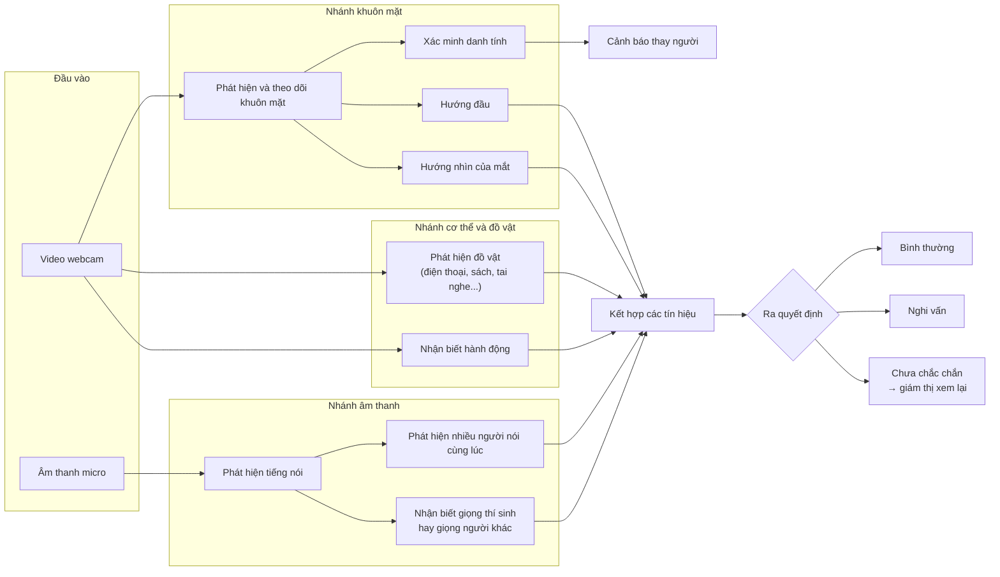

# Cheating Detection – Hệ thống hỗ trợ giám sát thi trực tuyến

Dự án nghiên cứu xây dựng hệ thống **phát hiện hành vi gian lận trong thi trực tuyến** từ video webcam và âm thanh micro của thí sinh.

Hệ thống **không thay thế giám thị**. Nó đánh dấu những đoạn đáng nghi, đồng thời nói rõ những ca nó không chắc chắn để giám thị xem lại. Nhờ vậy giám thị không phải xem toàn bộ video mà chỉ tập trung vào các đoạn cần thiết.

## Hệ thống làm gì?

Hệ thống quan sát thí sinh qua ba nhóm tín hiệu:

- **Khuôn mặt**: người đang thi có đúng là người đã đăng ký không, thí sinh có quay đầu hay nhìn ra ngoài màn hình lâu không.
- **Cơ thể và đồ vật**: có điện thoại, sách, tai nghe hay người thứ hai trong khung hình không; thí sinh có các hành động bất thường như với tay hay rời chỗ không.
- **Âm thanh**: có tiếng nói không, có nhiều người nói cùng lúc không, và giọng nói đó có phải của thí sinh không.

Sau đó hệ thống kết hợp các tín hiệu này để đưa ra một trong ba kết luận cho mỗi tình huống: **nghi vấn**, **bình thường**, hoặc **chưa chắc chắn – cần giám thị xem lại**.

## Sơ đồ tổng quan

## Nguyên tắc của dự án

- **Ưu tiên không bỏ sót**: mục tiêu là phát hiện được ít nhất 95% các tình huống gian lận.
- **Minh bạch khi không chắc chắn**: khi hình ảnh mờ, mất mặt hoặc mất tiếng, hệ thống ghi rõ lý do và chuyển cho người xem lại, không tự đoán.
- **Một tín hiệu đơn lẻ chưa phải là vi phạm**: ví dụ cúi xuống nhìn giấy nháp hợp lệ không bị coi là gian lận.
- **Đánh giá nghiêm túc**: dữ liệu kiểm tra cuối cùng được tách riêng theo từng người và chỉ dùng một lần.

## Trạng thái hiện tại

Dự án đang ở **giai đoạn lập kế hoạch thực nghiệm**: đã chọn mô hình cho từng thành phần, chưa tải dữ liệu và chưa có kết quả. Kế hoạch chi tiết từng bước nằm trong [experiment_plan.md](experiment_plan.md).

## Hạ tầng dự kiến

- 1–2 GPU RTX 3060 (12GB)
- Python ≥ 3.12
