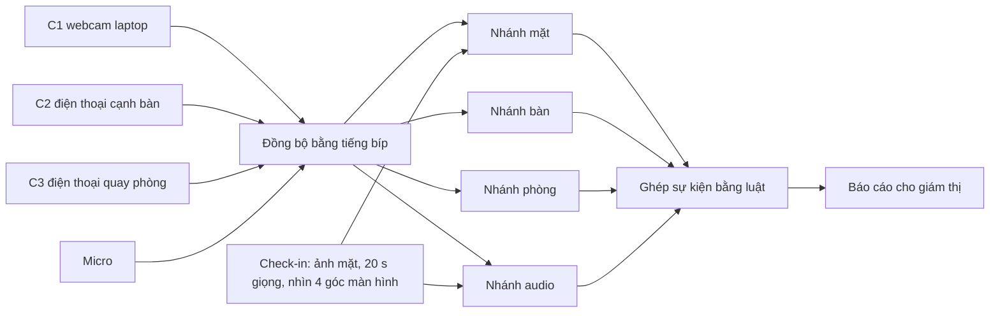

# Cheating Detection – Hệ thống hỗ trợ giám sát thi trực tuyến

Dự án nghiên cứu **phát hiện gian lận trong thi trực tuyến** từ 3 camera và micro của thí sinh, xử lý offline sau buổi thi.

Hệ thống **không thay thế giám thị**. Nó đánh dấu đoạn đáng nghi kèm bằng chứng (clip, đoạn âm thanh) để giám thị chỉ xem những đoạn cần thiết.

Phạm vi: bài thi kiểu IELTS Listening/Reading/Writing trong Safe Exam Browser, không giấy nháp, phòng đóng cửa.

## Hệ thống

| Nhánh | Nguồn | Đánh dấu |
|---|---|---|
| Mặt | Webcam laptop (C1) | Đổi người, mất mặt, nhìn ra ngoài màn hình (head pose + gaze) |
| Bàn | Điện thoại cạnh bàn (C2) | Tay rời bàn, điện thoại / giấy / tai nghe |
| Phòng | Điện thoại quay phòng (C3) | Người thứ hai, hoạt động ở cửa |
| Audio (phụ) | Micro | Giọng người khác (`other_voice`) |

Kết luận cho mỗi đoạn: **nghi gian lận** (≥ 2 nhánh cùng lúc, hoặc một dấu hiệu mạnh), **giám thị xem lại** (một dấu hiệu yếu), hoặc **bình thường**.

## Nguyên tắc

- **Một tín hiệu đơn lẻ chưa phải vi phạm**: ví dụ thí sinh nhẩm bài hay nhìn lên suy nghĩ không bị coi là gian lận.
- **Minh bạch khi mất tín hiệu**: mất mặt, mất camera, mất tiếng được ghi rõ lý do, không tự coi là bình thường.
- **Đánh giá nghiêm túc**: chia dữ liệu theo người, tập test khóa và chỉ dùng một lần; báo cả cảnh báo sai mỗi giờ.

## Tài liệu

- [docs/proposal.md](docs/proposal.md): thiết kế hệ thống, bộ dữ liệu, toàn bộ research question, lộ trình, nơi nộp paper.
- [docs/research/](docs/research/): research question + nguồn đọc từng nhánh ([audio](docs/research/audio.md), [đặt camera](docs/research/camera-position.md)).
- [docs/experiment_plan.md](docs/experiment_plan.md): các bước thực nghiệm theo từng research question.

## Cấu trúc repo

Mỗi thư mục có `README.md` riêng giải thích chi tiết.

| Thư mục | Chứa gì |
|---|---|
| [docs/](docs/README.md) | Đề xuất, kế hoạch thực nghiệm, research question + nguồn đọc từng nhánh |
| [data/](data/README.md) | Video, audio, nhãn, file chia tập (không commit) |
| [src/cheating_detection/](src/cheating_detection/README.md) | Code: io, placement, face, desk, scene, audio, fusion, eval |
| [experiments/](experiments/README.md) | Config + chỉ số của từng lần chạy |
| [scripts/](scripts/README.md) | Lệnh chạy end-to-end |
| [tests/](tests/README.md) | Test cho đồng bộ, chỉ số, luật ghép |
| [paper/](paper/README.md) | Bản thảo paper |

## Trạng thái

**Giai đoạn research question + literature review.** Chưa có code phân tích, chưa quay dữ liệu.

Cài môi trường: `uv sync` (Python ≥ 3.12). GPU: T4.
